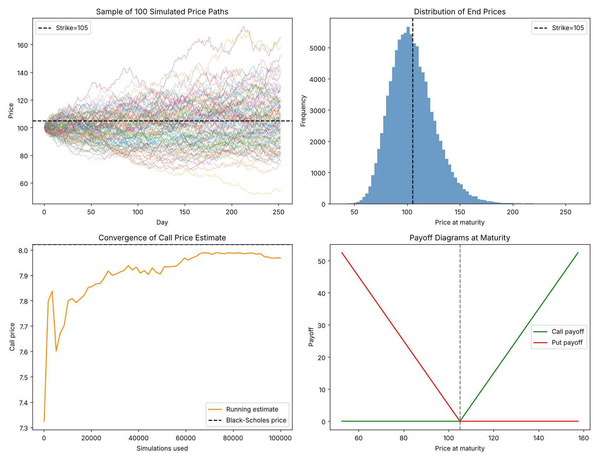

# Monte Carlo Option Pricing Model

A Python implementation that prices European call and put options via Monte Carlo simulation of Geometric Brownian Motion, and validates the result against the closed-form Black-Scholes formula.

## Overview

- Simulates 100,000 independent price paths using vectorised NumPy (Geometric Brownian Motion, 252 daily steps over 1 year)
- Prices both call and put options from simulated terminal payoffs, discounted at the risk-free rate
- Benchmarks the simulation against the analytical Black-Scholes price and reports a 95% confidence interval
- Result: Monte Carlo price lands within **1% of the Black-Scholes price** (call 0.66%, put 0.30%), and the Black-Scholes price sits inside the 95% confidence interval for both

## Example output

```
=======================================================
MONTE CARLO OPTION PRICING RESULTS
=======================================================
Parameters: price=100, strike=105, years=1.0, rate=0.05, vol=0.2
Simulations: 100,000  |  Steps/path: 252
-------------------------------------------------------
                   Monte Carlo     Black-Scholes      Diff
Call price              7.9683            8.0214   -0.0531
Put price               7.8769            7.9004   -0.0235
-------------------------------------------------------
Call 95% CI: [7.8869, 8.0496]
Put  95% CI: [7.8127, 7.9411]
=======================================================
```



## How it works

1. **Black-Scholes benchmark** — closed-form price computed directly from the standard formula.
2. **Path simulation** — each price path is generated by compounding daily log-returns drawn from a Geometric Brownian Motion process under the risk-neutral measure (drift = risk-free rate r):

   dS = rS dt + σS dW, simulated as S(t+dt) = S(t) · exp((r − σ²/2)dt + σ√dt · Z)

   implemented in log-space for numerical stability, and fully vectorised across all 100,000 paths at once.
3. **Pricing** — option payoffs are computed on the terminal prices, averaged, and discounted back to present value.
4. **Validation** — the Monte Carlo estimate is compared to Black-Scholes, with a 95% confidence interval computed from the standard error of the simulated payoffs.

## Requirements

```
numpy
scipy
matplotlib
```

Install with:

```bash
pip install -r requirements.txt
```

## Usage

```bash
python mc_option_pricer.py
```

This prints the pricing comparison to the console and saves `mc_simple.png` with the four diagnostic plots.

## Parameters

All parameters are set at the top of `mc_option_pricer.py` and can be edited directly:

| Parameter | Description | Default |
|---|---|---|
| `PRICE` | Current underlying price | 100 |
| `STRIKE` | Strike price | 105 |
| `YEARS` | Time to maturity (years) | 1.0 |
| `RATE` | Risk-free rate | 0.05 |
| `VOL` | Annualised volatility | 0.20 |
| `SIMS` | Number of simulated paths | 100,000 |
| `DAYS` | Trading days per year | 252 |

## Limitations

- European exercise only. American options need a different method (e.g. Longstaff-Schwartz least-squares Monte Carlo).
- Constant volatility and interest rate, no dividends, no volatility smile.
- GBM assumes log-normal returns, which understates tail risk in real markets.
- No variance reduction. Antithetic or control variates would cut the standard error for the same compute.

## License

MIT, see `LICENSE`.

## Author

Mikhail Peganov — BSc Artificial Intelligence, King's College London
